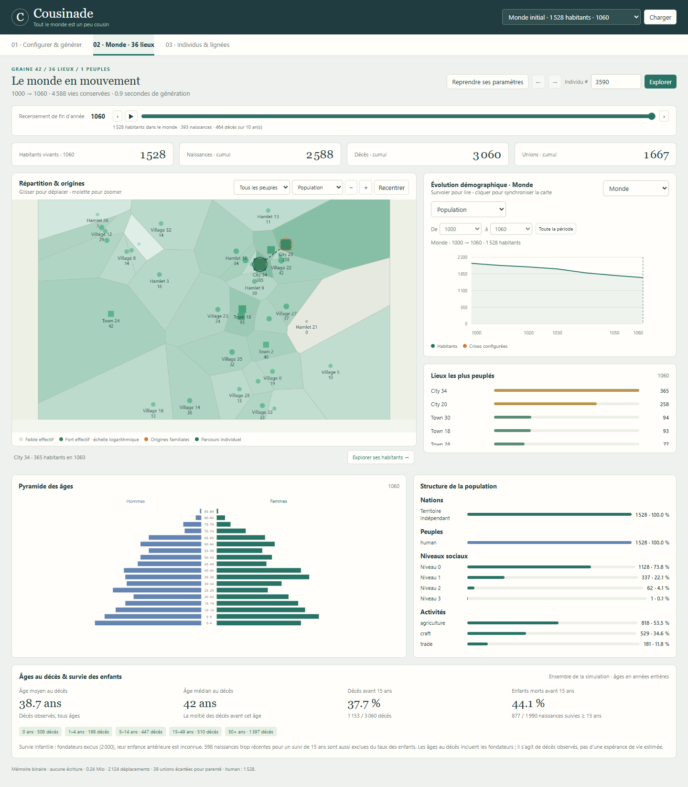

# Cousinade

Tout le monde est un peu cousin. Petit labo provisoire de populations et de lignées pour mondes imaginaires.




Projet autonome : Python, NumPy et Numba. Aucun LLM, compte, clé API, autre dépôt ou générateur de cartes nécessaire.

## Démo locale

Python 3.12 (version validée). Sous Windows : double-cliquer sur `demo.cmd` ; le premier lancement crée `.venv` et installe le projet. Ouvrir **http://127.0.0.1:8772** et garder le terminal ouvert.

```powershell
python -m venv .venv
.venv\Scripts\python.exe -m pip install -r requirements.lock
.venv\Scripts\python.exe -m pip install -e ".[dev]"
.venv\Scripts\python.exe -m cousinade studio --port 8772
```

Sous Linux/macOS, remplacer `.venv\Scripts\python.exe` par `.venv/bin/python`.
La première compilation Numba peut prendre quelques secondes. La démo démarre avec 2 000 personnes, 36 lieux et 60 années. Générer un monde, explorer la carte puis cliquer sur une personne et sa famille. Les préréglages médiéval, fantasy, civilisation et hybride sont inclus dans le paquet, même installé hors de ce dossier.

Le studio garde ses mondes en RAM ; fermer le serveur les libère. Importer/exporter une configuration permet de rejouer un monde. Pour **sauvegarder les histoires**, demander explicitement une archive :

```powershell
.venv\Scripts\python.exe -m cousinade generate config/genealogy/fantasy.yaml --output output/fantasy.sqlite
.venv\Scripts\python.exe -m cousinade explore output/fantasy.sqlite --port 8772
```

## Deux modèles, deux contrats

- `full` (défaut) : personnes, filiations et événements réellement simulés. Les ascendants antérieurs aux fondateurs sont inconnus. Tous les historiques conservés ont un coût mémoire.
- `hybrid` : noyau simulé et fond par cohortes ; familles ordinaires procédurales consultables à la demande. Approximations explicites, dont deux générations ascendantes et cinq descendantes pour le fond. Ce n'est pas la généalogie exhaustive du mode `full`.

Les règles sont des paramètres de fiction, pas une calibration historique. Les performances de 50 millions d'habitants sur mille ans ne sont pas démontrées. Les noms affichés sont provisoires ; ce projet ne dépend pas de Nomnom.

## Vérifier

```powershell
.venv\Scripts\python.exe -m pytest
.venv\Scripts\python.exe -m ruff check src tests
npm ci
# Avec le studio lancé sur 8772 ; Edge est le navigateur par défaut sous Windows.
npm run test:browser
$env:STUDIO_URL="http://127.0.0.1:8772"
npm run test:hybrid
```

`STUDIO_BROWSER` permet de choisir un exécutable Chromium/Edge. Les captures et calculs de tests vont dans `output/`, ignoré par Git.

## Repères

- [Guide d'utilisation](docs/genealogy.md)
- [Contrat du mode hybride](docs/genealogy-hybrid.md)
- [Architecture illustrée](docs/genealogy-architecture.html)
- [Mesures et limites historiques](docs/genealogy_review.md) : résultats de l'ancien environnement, pas des garanties de ce dépôt.
- [Origine de l'extraction](PROVENANCE.md)

Le code est dans `src/cousinade/`, les scénarios exemples dans `config/genealogy/`, les tests dans `tests/`. Les actifs du studio et scénarios sont également embarqués dans le paquet installable.
